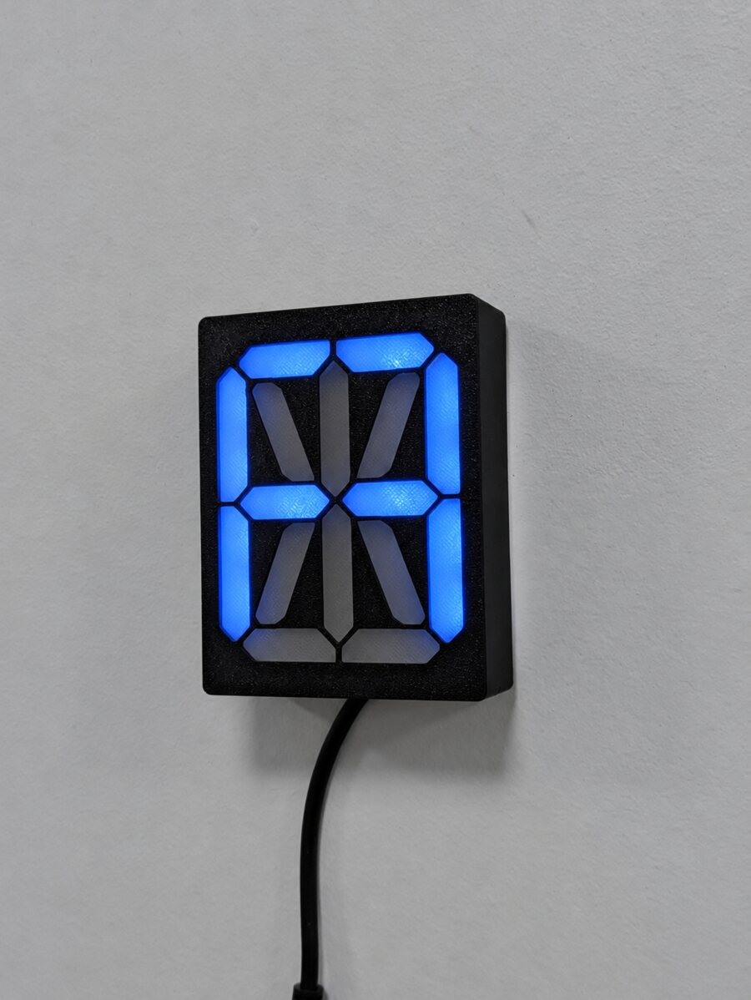
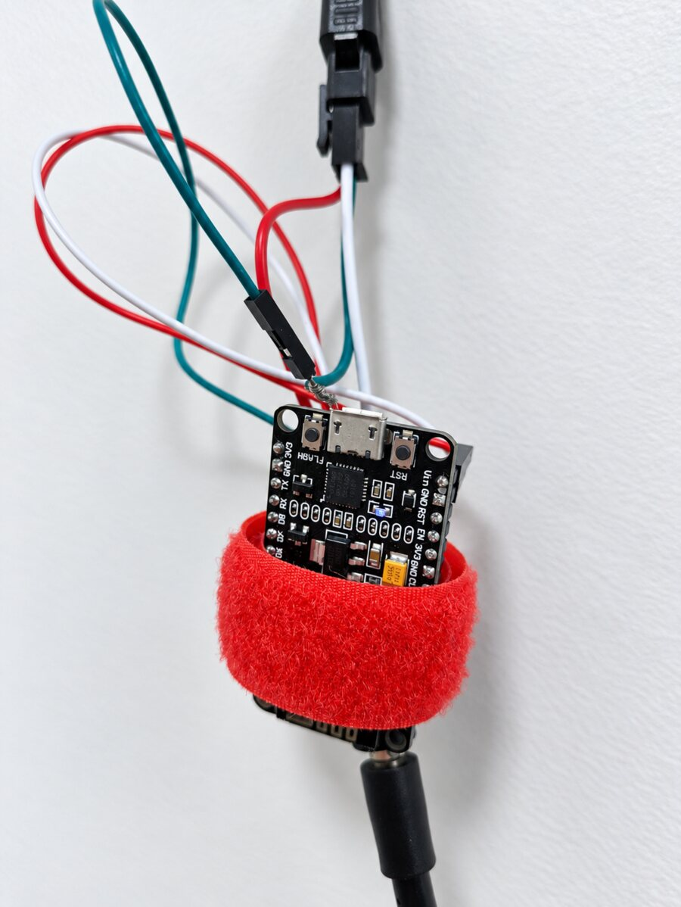
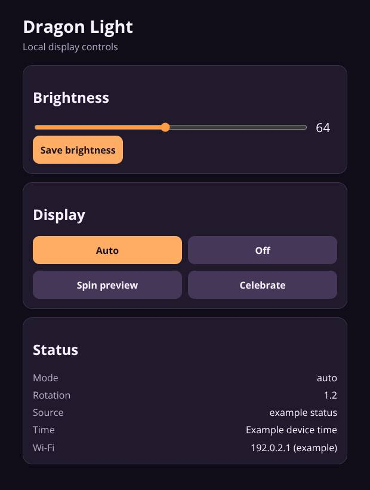
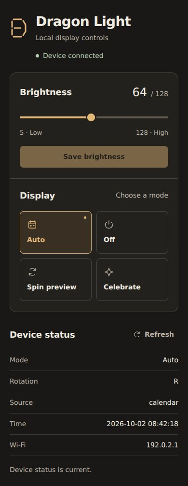
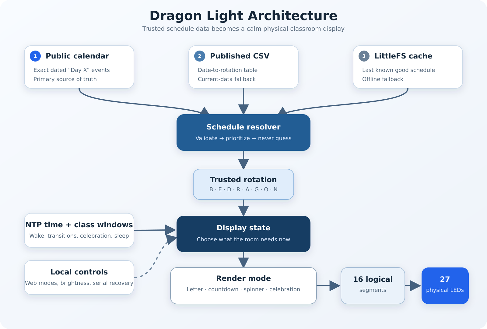

# Dragon Light

## About

Dragon Light is a wall-mounted ESP8266 and addressable-LED display built for an eight-day school rotation spelled **B E D R A G O N**. It reads the live school calendar, shows today's rotation letter at a glance, counts down class transitions, and turns off overnight.

The project combines classroom experience, physical prototyping, and embedded software to create a calm information object rather than another screen competing for attention.

## Preview

### Physical prototype

<table>
  <tr>
    <td align="center" width="50%">
      
    </td>
    <td align="center" width="50%">
      
    </td>
  </tr>
  <tr>
    <td align="center"><sub>The wall-mounted display showing an A day.</sub></td>
    <td align="center"><sub>The ESP8266, power, and data wiring during prototype assembly.</sub></td>
  </tr>
</table>

The physical build is working, but the translucent segment faces expose an enclosure tradeoff: at close range and higher brightness, light from active LEDs can spill into neighboring channels and soften the letter. The effect is less noticeable at normal classroom viewing distance, but it reduces clarity in photographs and darker rooms.

Current mitigation combines software and hardware. The local control page provides lower, persistent brightness settings; the model part labeled as a “diffuser” works more accurately as an opaque internal baffle; and a separate thin translucent front diffuser can be added to soften individual LED hotspots. Further iteration is focused on blocking cross-segment light without losing even illumination.

### Local control interface



The firmware's local control page, rendered with example device status. Brightness and display modes share one responsive panel, with a visible selected mode and connection feedback. The page runs directly from the device without external fonts, scripts, or services.

<details>
<summary>Mobile control interface</summary>

<p>The same controls at phone width, rendered with example device status.</p>


</details>

[Capture notes](docs/previews/README.md) record the source revision and demo conditions.

To explore the interface without the display, run:

```bash
python3 tools/preview_ui.py
```

Open `http://127.0.0.1:8040`. This local preview serves the exact embedded page with example status and simulated controls. Changes last only for the preview session; no hardware or calendar is connected.

## Design decisions and field lessons

| Constraint | What testing revealed | Design response |
| --- | --- | --- |
| The display should answer one question without becoming another distracting classroom screen. | More information would compete with the calm, glanceable purpose. | Keep the normal state to one large rotation letter, using motion only as brief secondary feedback. |
| The schedule changes during the year and should not require firmware edits. | A manually maintained CSV is useful as a fallback, but published links are easy to format incorrectly and duplicate a calendar that staff already updates. | Treat exact `Day X` events from the public school calendar as the authority, then fall back to current or cached CSV data. |
| The finished unit may be mounted out of reach. | Repeated USB access is inconvenient. | Add password-protected OTA updates and local web controls, while retaining USB and serial as recovery paths. |
| Joining the same Wi-Fi does not guarantee that devices can reach one another. | The managed school guest network allowed the ESP8266 to fetch its schedule but isolated local clients, blocking mDNS, the control page, and OTA access from a laptop. | Treat wireless administration as network-dependent, support direct-IP troubleshooting, and keep USB updating available instead of making OTA the only maintenance path. |
| Bright LEDs improve visibility but expose the enclosure's optical weaknesses. | Higher brightness increased spill into neighboring translucent segments and reduced letter clarity. | Save a lower brightness on-device, use the model's “diffuser” as an opaque baffle, and test a separate translucent front diffuser. |
| External schedule data can be missing, stale, or contradictory. | Guessing the rotation would make the object confidently wrong. | Prefer the calendar, retain a cached fallback, and show an unknown indicator or remain dark when the state cannot be trusted. |

Visual behavior was refined by the same rule: preserve readability first. The normal letter no longer “breathes,” the highlight sweep is brief and infrequent, the final-minute numeral became a clockwise spinner, and the end-of-day smiley was replaced with a cycle of abstract animations that better suits the segmented display.

## Where it stands

**Working classroom prototype.** USB flashing, Wi-Fi provisioning, LED rendering, and calendar-based rotation have been exercised on the installed unit. The managed school network currently prevents local wireless administration, so USB remains the dependable update and diagnostic path there. A formal 27-index LED-map verification and power-supply ceiling check are still open.

## How it works

- An ESP8266 drives a custom 16-segment display using addressable LEDs.
- A public calendar supplies the rotation letter, with a cached CSV fallback.
- A local web page controls brightness and previews animations.
- Wireless firmware updates support a display mounted out of reach.
- Missing schedule data produces an unknown indicator rather than a guessed day.

The firmware separates the physical LED routing from letters, effects, and scheduling. That makes it possible to change the enclosure or strip layout without rewriting the rest of the display.

### Architecture

<p align="center">
  
</p>

The schedule resolver uses explicit dated records rather than assuming the rotation advances every weekday. Display behavior then combines the trusted rotation with current time, while the final mapping layer isolates the unusual physical strip routing from the letter and animation logic.

## Explore the project

| If you want to… | Start here |
| --- | --- |
| Understand the decisions and remaining checks | [Project notes](docs/PROJECT_NOTES.md) |
| Build, configure, or troubleshoot the display | [Build and operating guide](docs/BUILD_GUIDE.md) |
| Review the wiring | [Hardware notes](docs/HARDWARE.md) |
| Understand the custom segment layout | [LED mapping](docs/LED_MAPPING.md) |
| Read the firmware | [Main application](src/main.cpp), [display mapping](src/display.cpp), [schedule handling](src/schedule.cpp) |

## Build the firmware

Requires PlatformIO. From the repository root:

```bash
pio run -e usb
```

Flashing and installation need the hardware and local configuration described in the build guide.

**Stack:** C++ · ESP8266 Arduino Core · FastLED · WiFiManager · PlatformIO.

The enclosure uses a purchased 3D model; its files are not redistributed here. Credits and installation limitations are documented in the [build guide](docs/BUILD_GUIDE.md). Project code is [MIT licensed](LICENSE).
